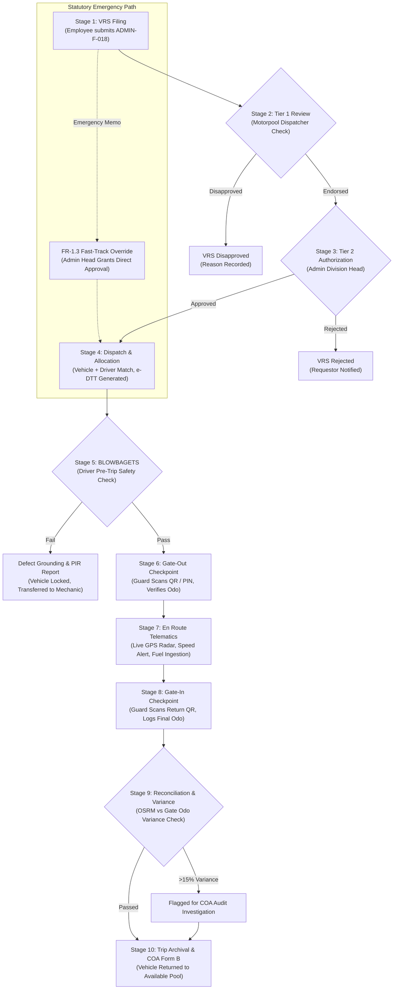

# BUSINESS REQUIREMENT DOCUMENT (BRD)
## Philippine Information Agency — Automated Fleet Management System (PIA-AFMS)

---

### Document Control & Metadata

| Attribute | Specification Details |
| :--- | :--- |
| **Document Reference** | `PIA-AFMS-BRD-2026-V2.1` |
| **System Title** | Philippine Information Agency Automated Fleet Management System (PIA-AFMS) |
| **Procuring / Sponsoring Agency** | Philippine Information Agency (PIA) — Office of the President |
| **Managing Division** | Administrative Division &amp; Motorpool Operations Section |
| **Document Version** | Version 2.1 (Production Baseline &amp; Vercel Deployment Release) |
| **Date of Final Review** | October 18, 2026 |
| **Statutory &amp; Audit Governance** | Commission on Audit (COA) Circulars 75-6 &amp; 2023-004; DBM Budget Circular No. 2022-1; Civil Service Commission (CSC) Fleet Guidelines |
| **Security Classification** | Restrictive Official Government Documentation |

---

## 1. Executive Summary & Purpose

The **Philippine Information Agency Automated Fleet Management System (PIA-AFMS)** is an enterprise government workflow automation platform engineered to modernize, control, audit, and optimize official ground travel operations across PIA Central, Regional, and Satellite operations.

Prior to PIA-AFMS, motorpool operations relied heavily on physical paper forms (`ADMIN-F-018` Vehicle Request Slips and `ADMIN-F-001` Driver's Trip Tickets), physical logbooks at security gates, manual fuel receipts, and post-audit paper reconciliations. This created operational bottlenecks:
1. **Approval Delays & Lost Slips:** Multi-day turnaround times for critical inter-agency press coverages.
2. **Audit Vulnerabilities:** Inaccurate odometer recording, untracked passenger delays, and manual fuel discrepancy reconciliations vulnerable to COA audit suspension notices.
3. **Safety Risks:** Inconsistent execution of the mandatory pre-trip safety inspection (BLOWBAGETS), leading to preventable roadside breakdowns.
4. **Asset Double-Booking:** Overlapping vehicle assignments during peak VIP coverage events.

PIA-AFMS replaces paper workflows with a synchronized, role-based web and mobile Progressive Web Application (PWA) operating on a 10-stage lifecycle with end-to-end auditability.

---

## 2. Stakeholder & Role-Based Access Control (RBAC) Matrix

The system implements strict government Segregation of Duties (SoD) across 8 distinct user roles:

| Role Name | Scope & Authority | Primary System Functions |
| :--- | :--- | :--- |
| **Super Admin (`admin`)** | Universal Administrative Control | System configuration, user account provisioning, role assignment, TOTP MFA management, immutable audit trail examination, and executive reports. |
| **Motorpool Dispatcher (`dispatcher`)** | Tier 1 Operational Control | Review submitted VRS slips, verify route validity, check vehicle/driver availability, endorse requests to Tier 2, execute dispatch allocations, issue e-DTTs, and manage RFID toll balances. |
| **Division Head / Approver Admin (`approver_admin`)** | Tier 2 Executive Clearance | Administrative Division Head (Atty. Julius S. De Peralta) acts as final approving authority for official travel; exercises Statutory Emergency Fast-Track Overrides (FR-1.3). |
| **Employee Requestor (`requestor`)** | Travel Request Origination | File VRS slips (`ADMIN-F-018 rev2`), submit emergency justification memos, monitor 4-hour SLA countdown, print authorized slips, and receive dispatch status alerts. |
| **Official Driver (`driver`)** | Transport Execution & Mobile Portal | Mobile PWA access (`/driver/trips`), execute mandatory 10-point BLOWBAGETS pre-trip inspections, record passenger delays (FR-4.2), log en-route fuel purchases, and report road incidents. |
| **Compound Security Guard (`guard`)** | Perimeter Access Verification | Checkpoint HUD terminal (`/gate`), live camera QR scanning, tactile 6-digit PIN verification, Gate-Out egress and Gate-In ingress odometer verification. |
| **Maintenance Mechanic (`maintenance`)** | Fleet Health & Workshop Queue | Pre-Repair Inspection Reports (PIR), service order work orders, 5,000 km / 10,000 km PMS scheduling, defect resolution, and vehicle release certifications. |
| **Resident COA Auditor (`auditor`)** | Regulatory Examination | Independent audit portal (`/audit`), monthly COA Form B generation, Cost-Per-Kilometer (CPK) analysis, odometer variance inspections, and Certificate of Non-Usage issuance. |

---

## 3. End-to-End Business Process Flows

### 3.1. The 10-Stage Official Travel Lifecycle

---

## 4. Functional Requirements Specification

### Functional Area 1: Travel Requisition & Multi-Tier Approval Chain

#### FR-1.1: Vehicle Request Slip (VRS) Electronic Submission
- **Official Form Reference:** `ADMIN-F-018 rev2`.
- **System Inputs:** Destination, specific official purpose, departure date/time, expected return date/time, passenger count, passenger manifest (names/divisions), preferred vehicle type, preferred driver (optional).
- **Business Rules:**
  - Standard travel requires minimum **24-hour advance submission** (`BR-01`).
  - Travel filed within less than 24 hours is automatically flagged as `is_rush_request = 1` and requires an uploaded PDF/image justification memo (`justification_file`) and justification remarks (`BR-03`).
- **Output:** System issues unique sequential identifier: `VRS-YYYY-XXXXX`.

#### FR-1.2: Two-Tier Approval Hierarchy
- **Tier 1 (Document Check & Endorsement):** Motorpool Dispatcher verifies schedule validity, route distance, and vehicle availability. The Dispatcher either endorses the slip or rejects with statutory justification.
- **Tier 2 (Final Executive Authorization):** Administrative Division Head (Atty. Julius S. De Peralta) examines the endorsed request and grants final administrative clearance.
- **Segregation of Duties:** The Tier 1 endorser cannot approve the request at Tier 2.

#### FR-1.3: Statutory Emergency Fast-Track Override
- **Authority:** Administrative Division Head or Super Admin only.
- **Operation:** Instantly transitions an urgent or disaster-response travel request directly to `approved` status, bypassing Tier 1 document queuing.
- **Post-Trip Accountability Rule:** The system automatically initializes `post_trip_doc_status = 'pending'` with a strict **48-hour deadline** (`post_trip_doc_due`). If the physical emergency justification and receipts are not submitted within 48 hours, the system flags the request as `overdue` and notifies the Resident COA Auditor.

#### FR-1.4: 4-Hour Approval SLA & Automatic Escalation
- **SLA Threshold:** When a VRS remains in `pending_dispatcher` status for more than **4 hours** (`sla_deadline < NOW()`), the background SLA Watcher auto-escalates the request to `pending_admin` and flags `is_sla_breached = 1`.
- **Notification:** High-priority email and in-app alert dispatched to the Administrative Division Head.
- **Final Expiry Backstop (BR-02):** If unactioned after 24 hours total, the request auto-expires with status `expired`.

#### FR-1.5: Rejection & Modification Feedback
- Any disapproval at Tier 1 or Tier 2 mandates a written justification recorded in `dispatcher_remarks` or `admin_remarks`. The employee receives an immediate notification explaining the disapproval.

---

### Functional Area 2: Motorpool Dispatch & Heuristic Allocation

#### FR-2.1: Fleet Segregation (Dedicated vs. Pool)
- Fleet assets are partitioned into:
  - **Dedicated Executive Units (`dedicated`):** Assigned permanently to Agency Executives (e.g., Director-General, Deputy Director-General); locked from general employee request queues.
  - **Shared Motorpool Pool (`pool`):** Available for algorithmic matching and employee travel allocation.

#### FR-2.2: Heuristic Vehicle & Driver Allocation Engine
- Evaluates candidate vehicles and drivers using a weighted multi-factor scoring matrix:
  1. **Seating Capacity Match (Weight: 25%):** Minimum capacity meeting passenger headcount without excessive vehicle overkill.
  2. **PMS Health & Odometer Window (Weight: 25%):** Proximity to upcoming 5,000 km service threshold. Vehicles near PMS are deprioritized for long-distance provincial trips.
  3. **Driver Availability & Workload Balance (Weight: 25%):** Verification of driver rest periods, active license certification, and cumulative monthly driving hours.
  4. **Vehicle Status & Lock Status (Weight: 25%):** Exclusion of units marked `maintenance`, `under_maintenance`, `disabled_breakdown`, or `pms_records.is_locked = 1`.

#### FR-2.3: Consolidated Carpool Dispatching (Multi-VRS Batch Merging)
- The Dispatcher may merge up to 5 compatible approved requests into a single trip ticket if:
  - Destination routes share geographic overlap (e.g., multiple bureaus traveling to Malacañang or Batasang Pambansa).
  - Departure and return windows coincide within a 60-minute interval.
  - Combined passenger headcount does not exceed vehicle certified seating capacity.
- The primary trip ticket captures `merged_request_ids` in JSON format, consolidating the passenger manifest and notifying all respective requestors.

---

### Functional Area 3: Driver's Trip Ticket & Compound Security Checkpoints

#### FR-3.1: Driver's Trip Ticket (e-DTT) Electronic Issuance
- **Official Form Reference:** `ADMIN-F-001 rev1`.
- **Structure:**
  - **Section A (Authority to Travel):** Auto-generated from approved VRS data, including serial number (`DTT-YYYY-XXXXX`), vehicle plate number, assigned driver, authorized destination, departure/return schedules, and certified passenger manifest.
  - **Section B (Dual Certification & Performance):** Captured en route and upon return (departure odometer, arrival odometer, actual fuel balance, toll expenses, and passenger certification).

#### FR-3.2: Cryptographically Signed HMAC-SHA256 QR Code
- Every issued e-DTT embeds a tamper-proof QR code generated using HMAC-SHA256 with the agency private secret:
  $$\text{Payload} = \text{SerialNo} \parallel \text{PlateNumber} \parallel \text{DriverCode} \parallel \text{DepartureTime}$$
  $$\text{Token} = \text{Base64Url}(\text{Payload}) \cdot \text{Substr}(\text{HMAC-SHA256}(\text{Payload}, \text{SecretKey}), 0, 32)$$
- Prevents falsification, unauthorized trip modifications, or unauthorized vehicle compound departure.

#### FR-3.3: Compound Gate Security HUD & Offline 6-Digit PIN Fallback
- Deployed at the PIA compound security guardhouse.
- **Scanner Interface:** Live camera feed with reticle overlay, torch toggle, and multi-sensory audio-haptic feedback.
- **Offline / Camera Failure Fallback:** 3x4 tactile numeric keypad allowing guards to enter a 6-digit numeric PIN, ticket serial number, or plate number.
- **Egress (Gate-Out) Validation:**
  - Verifies approved e-DTT status (`issued`).
  - Requires passed BLOWBAGETS safety checklist.
  - Records departure timestamp, guard identity, and starting odometer.
- **Ingress (Gate-In) Validation:**
  - Scans return QR code.
  - Records arrival timestamp, final odometer reading, fuel tank level, and verified passenger count.

#### FR-3.4: 15-Minute Passenger Delay Logging
- If passengers fail to board the dispatched vehicle within 15 minutes of authorized departure, the driver logs the delay via the Mobile PWA, recording passenger name and delay justification (`passenger_delay_logs`).
- Dispatcher receives an instant notification to adjust the motorpool schedule.

---

### Functional Area 4: Fleet Safety, Maintenance (PMS) & Incident Handling

#### FR-4.1: Mandatory Web BLOWBAGETS Pre-Trip Safety Checklist
- Before any vehicle can be cleared through the security gate, the assigned driver must complete an electronic 10-point BLOWBAGETS inspection:
  1. **B**attery (terminals, charge, corrosion)
  2. **L**ights (headlights, brake lights, signals, hazard)
  3. **O**il (engine oil level and condition)
  4. **W**ater (radiator coolant and wiper washer fluid)
  5. **B**rakes (fluid level, pad thickness, pedal travel)
  6. **A**ir (tire pressure including spare)
  7. **G**as (fuel level sufficient for authorized trip)
  8. **E**ngine (abnormal sounds, belt tension, leaks)
  9. **T**ires (tread depth, sidewall cracks, lug nuts)
  10. **S**elf (driver physical fitness, valid license, rest)
- **Defect Grounding:** If any critical item fails, the checklist result is recorded as `fail`. The vehicle status is immediately set to `under_maintenance`, and the gate checkpoint automatically locks the vehicle from egress.

#### FR-4.2: Automated Pre-Repair Inspection Report (PIR) Queue
- Fails on BLOWBAGETS or driver-submitted incident reports automatically generate a mechanic queue ticket (`pir_reports`) with sequential tracking number `PIR-YYYY-XXXXX`.
- Mechanics diagnose defects, record estimated parts/labor costs, log repairs, and perform post-repair road test sign-off before restoring the vehicle to `active` status.

#### FR-4.3: Preventive Maintenance System (PMS) 5,000 km / 10,000 km Watcher
- Tracks vehicle cumulative mileage against manufacturer maintenance thresholds.
- When odometer reaches within 500 km of next PMS, warnings appear in the Dispatch Console.
- When threshold is crossed, vehicle is locked (`is_locked = 1`) until an authorized service order is certified by the motorpool mechanic.

---

### Functional Area 5: Tollway RFID Management & Telematics Ingestion

#### FR-5.1: Dual RFID Provider Balance Management
- Tracks tollway transponders (AutoSweep for SLEX/Skyway/STAR/NAIAX and EasyTrip for NLEX/SCTEX/Cavitex/CALAX) per vehicle.
- Logs top-ups, toll deductions, and ending balances (`rfid_transactions`).
- **Low-Balance Warning:** Triggers automated dashboard and dispatcher warnings whenever an RFID card balance falls below **PHP 500.00**.

#### FR-5.2: Real-Time GPS Tracking, Geofencing & Overspeed Detection
- Telematics ingestion API receives GPS coordinates, speed, heading, and fuel telemetry.
- **Speed Watcher:** Automatic alert generated when vehicle exceeds government highway safety limits (**80 km/h**).
- **Geofence Audit:** Detects vehicle entry and exit across designated administrative regional boundaries.

---

### Functional Area 6: Regulatory Compliance, Audits & COA Standards

#### FR-6.1: Regulatory Document Expiry Watcher (LTO & GSIS)
- Continuously scans vehicle records for LTO registration expiry and GSIS comprehensive insurance expiry.
- Automatically issues notifications at **30 days, 15 days, and 7 days** prior to expiry. Expired vehicles cannot be dispatched.

#### FR-6.2: COA Form B Generation & Cost-Per-Kilometer (CPK) Analytics
- Automates compilation of the official **Monthly Report of Official Travels & Fuel Consumption (COA Form B)**.
- Reconciles total distance traveled, fuel consumed, cost of fuel, tollway fees, and computes CPK:
  $$\text{CPK} = \frac{\text{Total Fuel Cost} + \text{Total Toll Fees} + \text{Maintenance Allocations}}{\text{Total Verified Distance Traveled (km)}}$$

#### FR-6.3: Odometer Variance & Route Anomaly Detection
- Compares actual gate-to-gate odometer distance traveled against the Open Source Routing Machine (OSRM) optimized road distance.
- **Audit Flag Rule:** If actual distance exceeds calculated route distance by **over 15%**, the trip is flagged with `fuel_anomaly_flag = 1`.
- Drivers must submit written route explanations for COA auditor clearance before travel expense vouchers can be liquidated.

#### FR-6.4: Monthly Certificate of Non-Usage
- Under COA rules, government vehicles that remained idle or parked for an entire calendar month must have an official Certificate of Non-Usage filed with the agency resident auditor to prevent fraudulent fuel allocation claims.
- The system automatically scans the fleet at month-end and generates printable certificates (`compliance/certificate/{id}`) for all units with zero trip tickets.

---

## 5. Non-Functional Requirements (NFRs)

| ID | Requirement Category | Specification Standard |
| :--- | :--- | :--- |
| **NFR-1** | **Performance & Latency** | Core page load under 1.5s on 4G networks; gate QR scan verification executed within $\le 300\text{ ms}$; API telemetry ingestion throughput supporting up to 50 concurrent vehicle pings per second. |
| **NFR-2** | **Access Control & Security** | Passwords hashed using `Argon2id` (RFC 9106); optional RFC 6238 Time-based One-Time Password (TOTP) Multi-Factor Authentication; role-based route filters (`AuthFilter` + `RoleFilter`); CSRF protection enabled on all authenticated web forms; TLS 1.3 enforced. |
| **NFR-3** | **Immutable Auditability** | All critical business actions (approvals, fast-track overrides, dispatch allocations, gate egress/ingress, login failures) written to an append-only `system_audit_logs` table recording user ID, role, event type, IP address, user agent, and timestamp. Records cannot be updated or deleted via UI. |
| **NFR-4** | **Serverless Compatibility** | Fully compatible with Vercel Serverless PHP runtime (`vercel-php`); session storage persisted in database (`sessions` table) to maintain session continuity across ephemeral serverless container cold starts; zero dependency on persistent local filesystem state. |

---

## 6. Official Government Statutory Rules (Business Rules Catalog)

| Rule ID | Rule Name | Description & Enforcement Mechanism |
| :--- | :--- | :--- |
| `BR-01` | **24-Hour Advance Notice** | All non-emergency official travel requests must be filed at least 24 hours prior to scheduled departure. |
| `BR-02` | **24-Hour Final SLA Expiry** | Requests not finalized within 24 hours of filing automatically lapse to `expired` status to prevent stale vehicle reservations. |
| `BR-03` | **Emergency Justification Gate** | Trips filed with less than 24 hours notice must attach an authorized Division Justification memo. |
| `BR-04` | **4-Hour Tier 1 Escalation** | Tier 1 Dispatcher queue items older than 4 hours automatically escalate to the Administrative Division Head. |
| `BR-05` | **Mandatory Safety Clearance** | No vehicle may exit the agency compound without a `pass` rating on its pre-trip BLOWBAGETS inspection. |
| `BR-06` | **15% Odometer Variance Threshold** | Any trip with actual gate distance exceeding calculated distance by $>15\%$ is locked for audit examination. |
| `BR-07` | **RFID Low-Balance Alert** | AutoSweep and EasyTrip cards with balances below PHP 500 trigger automated top-up notifications. |
| `BR-08` | **Post-Trip Emergency Document Due** | Travel executed under FR-1.3 emergency fast-track override mandates documentation submission within 48 hours of return. |

---

## 7. Document Acceptance & Regulatory Sign-Off

This Business Requirement Document reflects the operational specifications, government compliance mandates, and statutory rules approved for the Philippine Information Agency Automated Fleet Management System.

**Prepared By:**  
Technical Architecture &amp; Engineering Team  
PIA-AFMS Project  

**Approved By:**  
**Atty. Julius S. De Peralta**  
Head, Administrative Division  
Philippine Information Agency  
