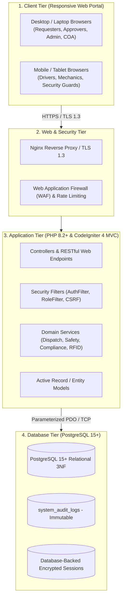
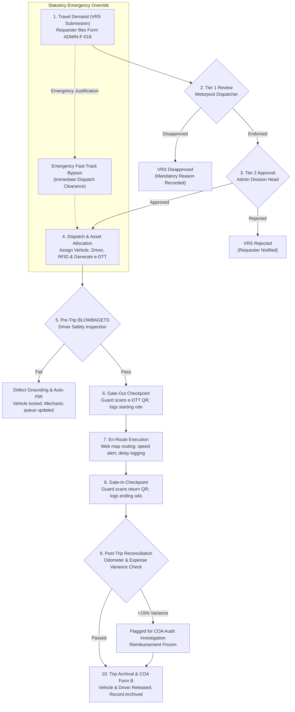

# PHILIPPINE INFORMATION AGENCY
## AUTOMATED FLEET MANAGEMENT INFORMATION SYSTEM (PIA-AFMS / FLEET)
### COMPREHENSIVE BUSINESS REQUIREMENTS & FUNCTIONAL SPECIFICATION DOCUMENT (BRD)

---

| Document Control Attribute | Specification Details |
| :--- | :--- |
| **Document Reference** | `PIA-MISD-AFMS-BRD-2026-V3.0` |
| **System Title** | Philippine Information Agency Automated Fleet Management System (PIA-AFMS / FLEET) |
| **Document Classification** | Restrictive Official Government Documentation — For Official Agency Use |
| **Project Authors / Leads** | Jairus John Deleste Valdez & Job Orias De Leon |
| **Lead Technical Division** | Management Information Systems Division (MISD) |
| **Lead Operational Division** | Administrative Division – Motorpool Section |
| **Effective Date / Baseline** | October 20, 2026 |
| **Statutory & Audit Governance** | Commission on Audit (COA) Circulars 75-6, 2023-004; DBM Budget Circular No. 2022-1; CSC Fleet Safety Directives; Republic Act 10173 (Data Privacy Act of 2012) |

---

## 1. Executive Summary & Business Purpose

### 1.1 Background & Operational Context
The Philippine Information Agency (PIA), an attached agency under the Office of the President, manages and operates a fleet of official motor vehicles deployed at the Central Office (Visayas Avenue, Quezon City) and across Regional Offices nationwide. 

Prior to this system, motorpool operations relied heavily on physical paper forms (`ADMIN-F-018` Vehicle Request Slips, `ADMIN-F-001` Driver's Trip Tickets, paper BLOWBAGETS checklists, and Pre-Repair Inspection Reports), physical logbooks at security gate checkpoints, and disparate spreadsheets. This manual paradigm resulted in:
1. **Approval Bottlenecks & Lost Requests:** Multi-day delays when securing signatures for critical government media dispatches, VIP coverages, and disaster responses.
2. **Audit Vulnerabilities:** Discrepancies between logged trip distance, actual odometer readings, and fuel disbursements, resulting in inquiries and suspension notices from the Commission on Audit (COA).
3. **Safety & Preventive Maintenance Deficits:** Inconsistent execution of mandatory pre-trip safety checks (BLOWBAGETS), leading to preventable en-route vehicle breakdowns.
4. **Asset Double-Booking & Sub-Optimal Allocation:** Overlapping schedules during high-demand media deployments and lack of visibility into dedicated versus pool assets.
5. **Disconnected Inventory & Expense Records:** Untracked spare parts consumption, manual toll replenishment, and untracked RFID balances (AutoSweep and EasyTrip).

### 1.2 System Purpose
The **Philippine Information Agency Automated Fleet Management System (PIA-AFMS / FLEET)** centralizes and automates vehicle requisitions, multi-tier approvals, vehicle-driver dispatching, checkpoint validations, pre-trip safety, maintenance ticketing, parts inventory, RFID financial monitoring, and regulatory COA reporting into a unified, server-validated digital platform.

---

## 2. System Scope & Boundaries

### 2.1 In-Scope Capabilities
1. **Centralized Web Portal:** Role-restricted web dashboards serving Requesters, Approvers, Dispatchers, Drivers, Mechanics, Security Guards, and Auditors.
2. **Digital VRS & Multi-Tier Approval Engine:** 24-hour lead time validation, justification file attachments, 4-hour SLA auto-escalation, and statutory emergency fast-track overrides.
3. **Fleet Categorization & Visual Schedule Visualizer:** Management and scheduling of dedicated executive vehicles versus shared general motorpool pool units.
4. **Motorpool Dispatching & Allocation Engine:** Automated and manual vehicle-driver pairing, conflict detection, and multi-request carpool batching.
5. **Web Driver Portal & Route Planning:** Browser-based driver dashboard for assigned dispatches, embedded web map route calculation (distance, geometry, ETA), delay reporting, and incident ticketing.
6. **Electronic Driver Trip Ticket (e-DTT) & Gate Verification:** Cryptographically signed QR code generation with 6-digit PIN fallback for compound gate check-in/check-out.
7. **Pre-Trip Safety (BLOWBAGETS) & Auto-PIR Trigger:** Mandatory 10-point digital checklist with automatic safety-lock grounding and Pre-Repair Inspection Report (PIR) ticketing upon defect discovery.
8. **Fleet Asset, Maintenance & Inventory Management:** Vehicle profiles, PMS schedules (5,000 km / 10,000 km thresholds), repair histories, spare parts inventory, and issuance tracking.
9. **Tollway RFID & Expense Tracking:** Real-time tracking of AutoSweep and EasyTrip balances, card reloads, toll expense reconciliation, and low-balance alerts (< ₱500).
10. **Regulatory Compliance & COA Analytics:** Automated generation of COA Monthly Report of Official Travel (Form B), Monthly Fuel Consumption Report, Certificate of Non-Usage, and 30-day LTO/GSIS expiry alerts.
11. **Driver Management & Performance Records:** Driver profiles, rendered service hours, accident/incident records, and customer feedback collection.
12. **Server-Side Security & Immutable Audit Logging:** Argon2id password encryption, TOTP MFA, parameterized queries, and immutable transaction logs.

### 2.2 Out-of-Scope Capabilities
- **Downloadable Native Mobile Apps:** No downloadable Android APKs, iOS IPAs, or offline PWA application stores. The platform is strictly an online web application accessed via standard web browsers.
- **Hardware OBD-II Engine Telematics Devices:** No physical OBD-II dongles or hardwired GPS trackers installed in engine bays; route distance and navigation rely on web maps and gate-to-gate verified odometer readings.
- **Driver Payroll & Compensation Integration:** Driver overtime, travel per diems, and payroll compensation processing remain handled by the HRDD payroll system.
- **Agency Procurement & Financial Accounting ERP:** Full-scale procurement management and general ledger financial accounting remain within agency finance systems.

---

## 3. Stakeholder & Role-Based Access Control (RBAC) Matrix

All system users access the platform through standard modern web browsers (Chrome, Firefox, Edge, Safari) over TLS 1.3 encrypted HTTPS.

| Role Code | Role Name | Target Users / Office | Scope & Key System Responsibilities |
| :--- | :--- | :--- | :--- |
| `requestor` | **Requisitioner** | PIA Central & Regional Employees, Division Staff | Files digital VRS (`ADMIN-F-018`), uploads late justification memos, tracks real-time approval status, submits post-trip feedback. |
| `dispatcher` | **Tier 1 Approver & Motorpool Dispatcher** | Motorpool Chief, Assigned Dispatchers | Performs operational feasibility reviews, checks vehicle/driver availability, endorses VRS to Tier 2, executes dispatches, manages RFID balances. |
| `approver_admin`| **Tier 2 Final Approver** | Administrative Division Head | Reviews endorsed requisitions, grants official agency approval, executes statutory Emergency Fast-Track Overrides. |
| `driver` | **Official Driver** | Motorpool Agency Drivers | Accesses Driver Web Portal, performs pre-trip BLOWBAGETS checks, views routes and itineraries, logs passenger delays, fuel receipts, and toll usage. |
| `guard` | **Compound Security Guard** | Building Security Personnel | Operates Gate Terminal HUD, scans e-DTT QR codes (with 6-digit PIN fallback), validates departure/arrival timestamps, verifies odometer readings. |
| `maintenance` | **Maintenance Mechanic** | Motorpool Mechanics, Technical Staff | Receives automated PIR tickets, records pre-repair inspections, logs spare parts consumption, records PMS, certifies vehicles fit for service. |
| `auditor` | **Resident COA Auditor** | COA Resident Audit Team | Inspects flagged odometer/fuel anomalies (>15%), reviews monthly COA Form B exports, issues Certificates of Non-Usage for idle assets. |
| `admin` | **System Administrator** | MISD Technical Staff | Configures system parameters, manages user provisioning and RBAC roles, enforces security policies, inspects immutable audit logs. |

---

## 4. Technical Architecture & Security Model

### 4.1 Technology Stack
- **Backend Language:** PHP 8.2+
- **Application Framework:** CodeIgniter 4 (CI4) MVC
- **Authentication & Security:** CodeIgniter Shield with `Argon2id` password hashing and RFC 6238 TOTP Multi-Factor Authentication for privileged roles.
- **Presentation Tier:** CodeIgniter Views & View Cells styled with responsive Bootstrap 5 / Tailwind CSS.
- **Database Engine:** PostgreSQL 15+ Relational Database (3rd Normal Form).
- **Session Management:** Database-backed sessions (`HttpOnly`, `Secure`, `SameSite=Strict`).
- **Route & Map Engine:** Web-based integration (OSRM / OpenStreetMap / Google Maps Embed) for coordinates, distance calculation, and geometry.

---

## 5. End-to-End Operational Lifecycle & Workflows

### 5.1 The 10-Stage Official Travel Workflow

---

## 6. Detailed Functional Business Requirements

### Module 1: Vehicle Requisition & Multi-Tier Approval Chain

#### FR-1.1: Web VRS Submission (`ADMIN-F-018`)
- The system shall provide an intuitive web form allowing authenticated personnel to submit travel requisitions including departure date/time, return date/time, exact destinations, travel purpose, passenger headcount, and passenger manifest.
- **Acceptance Criteria:**
  - Submission generates a unique sequential identifier: `VRS-YYYY-XXXXX`.
  - Requesters can track live status updates across the approval workflow.

#### FR-1.2: 24-Hour Lead Time Rule & Justification Attachment
- Requisitions must be filed at least **24 hours** prior to scheduled departure.
- If submitted within less than 24 hours, the system marks the request as rush (`is_rush_request = 1`) and strictly prevents submission unless an authorized division justification memo (PDF or image) is uploaded.
- **Acceptance Criteria:**
  - Form validation blocks submissions < 24 hours without an attached file.
  - Attached files are stored in `writable/uploads/` outside the public web root.

#### FR-1.3: Two-Tier Approval Hierarchy
- **Tier 1 (Operational Review):** Motorpool Dispatcher verifies scheduling feasibility, route validity, and asset availability, then endorses or rejects.
- **Tier 2 (Administrative Clearance):** Administrative Division Head reviews endorsed requests and grants final travel authorization.
- **Acceptance Criteria:**
  - Segregation of duties prevents Tier 1 endorsers from granting Tier 2 approval.
  - System logs timestamps and approver user IDs for each action.

#### FR-1.4: 4-Hour Approval SLA & Automatic Escalation
- If a Tier 1 dispatcher does not act upon a pending VRS within **4 hours**, the system issues an email notification and automatically escalates the item to the Administrative Division Head.
- If unacted upon after **24 hours total**, the request auto-expires with status `expired` to prevent stale reservation holds.
- **Acceptance Criteria:**
  - SLA watcher job runs continuously, updating `is_sla_breached = 1` and triggering escalation notices.

#### FR-1.5: Statutory Emergency Fast-Track Override
- For crisis response, presidential media coverage, and sudden emergency press runs, the Administrative Division Head or Motorpool Head may trigger an emergency override, bypassing normal lead times and queues.
- **Acceptance Criteria:**
  - Request immediately transitions to `approved`.
  - System initializes `post_trip_doc_status = 'pending'` with a strict **48-hour deadline**. If post-trip justification is not uploaded within 48 hours, the request is flagged as `overdue` and alerted to COA.

#### FR-1.6: Mandatory Rejection Remarks
- Disapproving a request at any stage requires a mandatory written reason. The system dispatches an automated notification with documented remarks to the requester.

---

### Module 2: Fleet Categorization & Asset Allocation

#### FR-2.1: Fleet Segregation
- Fleet assets shall be strictly categorized into:
  1. **Dedicated Units:** Reserved permanently for Agency Executives (e.g., Director-General, Deputy Director-General) and specific divisions; locked from general requisition.
  2. **Shared Motorpool Pool Units:** Available for general agency travel allocation.
- **Acceptance Criteria:**
  - Dedicated vehicles cannot be selected for general staff travel requests.

#### FR-2.2: Interactive Visual Scheduling Calendar
- The Motorpool Dispatcher console shall provide an interactive visual calendar displaying real-time vehicle and driver reservations, maintenance blocks, and availability schedules to eliminate double-booking.

#### FR-2.3: Heuristic Vehicle & Driver Matching
- The system evaluates candidate vehicles and drivers based on:
  - Seating capacity match relative to passenger manifest.
  - Odometer proximity to scheduled 5,000 km / 10,000 km PMS service.
  - Driver rest periods and cumulative monthly driving hours.
  - Vehicle readiness (excluding grounded, in-repair, or expired units).

#### FR-2.4: Consolidated Carpool Dispatching (Batch Merging)
- The Dispatcher may consolidate up to 5 compatible approved requests into a single trip ticket if destination routes share geographic proximity, travel windows overlap within 60 minutes, and passenger count does not exceed vehicle capacity.

---

### Module 3: Driver Web Portal, Routing & Privacy

#### FR-3.1: Browser-Based Driver Portal
- Drivers access an optimized web portal via smartphone, tablet, or PC browser (`/driver/trips`) to review assigned itineraries, departure schedules, and passenger manifests.

#### FR-3.2: Data Privacy & Driver Record Segregation (RA 10173)
- The system enforces server-side record-level access control (RBAC) and database query filters. Drivers can strictly view only their explicitly assigned trips.
- Access to other drivers' itineraries, passenger personal contact details, or historical logs is strictly prohibited in compliance with Republic Act 10173 (Data Privacy Act of 2012).

#### FR-3.3: Embedded Web Map Route Guidance
- The Driver Web Portal shall embed an interactive map displaying departure and destination points, calculated route geometry, estimated distance (km), and estimated travel time.

#### FR-3.4: 15-Minute Passenger Delay Logging
- If passengers fail to board the vehicle within 15 minutes of scheduled departure, the driver logs the delay via the web portal. The system timestamps the delay reason and alerts dispatchers.

---

### Module 4: Electronic Driver Trip Tickets (e-DTT) & Checkpoints

#### FR-4.1: Electronic Trip Ticket Generation (`ADMIN-F-001`)
- The system automatically generates the official e-DTT upon dispatch approval, containing:
  - **Section A (Authority):** Serial number (`DTT-YYYY-XXXXX`), vehicle plate number, driver name, destination, schedule, and passenger list.
  - **Section B (Travel Performance):** Departure/arrival timestamps, odometer readings, fuel consumption, and toll expenditures.

#### FR-4.2: Cryptographic QR Code & Tactile 6-Digit PIN
- Every e-DTT includes an HMAC-SHA256 cryptographically signed QR code to prevent tampering or falsified passes.
- A paired 6-digit numeric PIN is generated for offline or camera-failure fallback at security checkpoints.

#### FR-4.3: Gate-Out (Egress) Compound Clearance
- Security guards at the compound gate scan the driver’s e-DTT QR code (or input the 6-digit PIN) via the Gate HUD terminal.
- The gate terminal verifies that:
  - The e-DTT is officially issued and valid for departure.
  - Pre-trip safety inspection (BLOWBAGETS) is completed and marked `pass`.
- Guard records departure timestamp and starting odometer reading.

#### FR-4.4: Gate-In (Ingress) Compound Return Clearance
- Upon return, security guards scan the e-DTT QR code, logging arrival timestamp, return odometer reading, fuel gauge status, and passenger headcount.

#### FR-4.5: Customer Feedback Collection
- Upon trip completion, the system sends an electronic feedback prompt to the lead passenger to rate driver professionalism, vehicle condition, and timeliness.

---

### Module 5: Pre-Trip Safety (BLOWBAGETS) & Maintenance (PIR)

#### FR-5.1: Mandatory 10-Point Web BLOWBAGETS Checklist
- Prior to departure, the assigned driver must inspect and electronically certify all 10 safety checkpoints:
  1. **B**attery (terminals, charge, corrosion)
  2. **L**ights (headlights, signals, hazards, brake lights)
  3. **O**il (engine oil level and condition)
  4. **W**ater (radiator coolant and windshield washer)
  5. **B**rakes (fluid level, pad wear, pedal response)
  6. **A**ir (tire pressure including spare tire)
  7. **G**as (fuel level sufficient for designated trip)
  8. **E**ngine (belts, leaks, abnormal noises)
  9. **T**ires (tread depth, wheel nuts, sidewall integrity)
  10. **S**elf (driver physical fitness, valid license, adequate rest)

#### FR-5.2: Fail-Safe Safety Lock & Automated PIR Trigger
- If any checklist item is flagged as `Failed`, the vehicle is immediately grounded with status `under_maintenance`.
- The gate checkpoint is locked to prevent vehicle exit.
- The system automatically generates a Pre-Repair Inspection Report ticket (`PIR-YYYY-XXXXX`) routed to the mechanic workshop queue.

#### FR-5.3: Mechanic Repair & PMS Recalibration Workflow
- Mechanics log into the maintenance queue to record pre-repair diagnoses, requisition parts, log repair actions, and certify roadworthiness before returning the asset to `active` status.

#### FR-5.4: Preventive Maintenance System (PMS) 5,000 km / 10,000 km Lock
- The system monitors odometer mileage against maintenance cycles.
- Advance warnings appear at 500 km prior to threshold.
- Upon crossing the threshold, the vehicle is locked (`is_locked = 1`) from dispatch until PMS service is certified by the motorpool mechanic.

---

### Module 6: Spare Parts & Supplies Inventory Management

#### FR-6.1: Parts Catalog & Stock Monitoring
- The system shall maintain an inventory of vehicle spare parts and consumables (tires, batteries, engine oil, brake pads, filters, bulbs, fluids).
- Each item record contains SKU/part number, description, category, unit of measure, minimum reorder stock level, and current balance on hand.

#### FR-6.2: Stock Movements & Issuance Tracking
- The system shall record all stock additions (deliveries/acquisitions) and issuances tied directly to a specific vehicle repair ticket (PIR) or PMS work order.
- Inventory balances automatically update upon transaction completion.

#### FR-6.3: Low-Stock Reorder Alerts
- When inventory levels fall below the designated threshold, the system issues automated dashboard notifications to the Motorpool Head and MISD.

---

### Module 7: Tollway RFID & Fleet Expense Management

#### FR-7.1: Dual RFID Transponder Tracking
- The system tracks AutoSweep (SLEX, Skyway, STAR, NAIAX) and EasyTrip (NLEX, SCTEX, CAVITEX, CALAX) account numbers and real-time ledger balances for each vehicle.

#### FR-7.2: Toll Expense & Card Reload Logging
- Drivers record toll fees and upload receipt photos via the e-DTT web form.
- Dispatchers record official top-ups and balance adjustments on the web portal.

#### FR-7.3: Low-Balance Automated Warning
- The system issues an automated warning to the Motorpool Head whenever an RFID account balance drops below **₱500.00**.

---

### Module 8: Regulatory Compliance & COA Audit Reporting

#### FR-8.1: LTO Registration & GSIS Insurance Expiry Monitoring
- The system continuously monitors vehicle LTO registration and GSIS insurance expiration dates.
- Automated web and email alerts are issued **30 days, 15 days, and 7 days** prior to expiry. Expired vehicles are locked from dispatch.

#### FR-8.2: COA Form B Generation & Export
- The system automatically compiles and exports the official **Monthly Report of Official Travel and Fuel Consumption (COA Form B)**, summarizing driver, vehicle plate, distance traveled, fuel purchases, and passenger manifests.

#### FR-8.3: Cost-Per-Kilometer (CPK) & Fuel Efficiency Analytics
- The system calculates kilometer-per-liter rates and computes Cost Per Kilometer:
  $$\text{CPK} = \frac{\text{Fuel Cost} + \text{Toll Expenditures} + \text{Maintenance Allocations}}{\text{Total Verified Distance Traveled (km)}}$$
- Identifies anomalies in fuel consumption against vehicle benchmark standards.

#### FR-8.4: 15% Odometer Variance & Audit Anomaly Queue
- The system compares verified gate-to-gate travel distance against standard map route distance.
- If variance exceeds **15%**, the trip is flagged as an `Audit Anomaly`, driver expense reimbursement is frozen, and the file is routed to the COA Resident Auditor for investigation.

#### FR-8.5: Certificate of Non-Usage
- Under COA rules, vehicles that remain idle for an entire calendar month must have an official Certificate of Non-Usage filed to prevent unlawful fuel claims.
- The system auto-generates printable certificates for idle vehicles at month-end.

---

### Module 9: Driver Profile & HR Operational Tracking

#### FR-9.1: Driver Profile & Certification Records
- The system maintains detailed driver profiles including license number, license expiration date, authorized vehicle classes, assigned regular vehicle, and emergency contacts.
- Alerts are triggered 30 days prior to driver license expiration.

#### FR-9.2: Rendered Service Hours & Workload Distribution
- System monitors cumulative driving hours and active assignments to prevent driver fatigue and ensure balanced workload distribution.

#### FR-9.3: Incident & Accident Reporting
- The system maintains a complete log of all road accidents, breakdowns, and traffic citations associated with vehicles and drivers.

---

### Module 10: System Administration & Immutable Audit Logging

#### FR-10.1: Server-Side Authentication & Session Management
- Passwords secured with `Argon2id` hashing algorithm.
- RFC 6238 TOTP Multi-Factor Authentication enforced for Administrators, Motorpool Dispatchers, and Executive Approvers.
- Sessions stored in encrypted PostgreSQL database tables (`HttpOnly`, `Secure`, `SameSite=Strict`).

#### FR-10.2: Immutable Audit Trail (`system_audit_logs`)
- All critical events (login attempts, approvals, emergency overrides, dispatch allocations, gate egress/ingress, maintenance status changes, and record updates) are logged to an append-only audit table.
- System logs capture User ID, Role, IP Address, User Agent, Timestamp, Event Type, and Payload. Audit logs are non-editable and non-deletable.

---

## 7. Non-Functional Requirements (NFRs)

| NFR ID | Quality Attribute | Technical Requirement Standard |
| :--- | :--- | :--- |
| **NFR-1** | **Performance & Latency** | Web portal pages render within $\le 2.0\text{ seconds}$ on standard connectivity. Checkpoint QR scanning / PIN validation executes within $\le 500\text{ ms}$. |
| **NFR-2** | **Availability & Uptime** | High availability with at least 99% uptime during official government operating hours (07:00 – 19:00 PST). |
| **NFR-3** | **Security & Integrity** | 100% server-side validation using CodeIgniter 4 controller filters; parameterized PDO bindings; CSRF token protection on all state-changing requests; XSS prevention via global `esc()` and Content Security Policy (CSP). |
| **NFR-4** | **Data Privacy** | Strict compliance with RA 10173 (Data Privacy Act of 2012). Passenger contact information and travel itineraries are segregated and masked from unauthorized drivers. |
| **NFR-5** | **Reliability & Backups**| Automated daily database backups with documented disaster recovery procedures and zero loss of committed audit logs. |
| **NFR-6** | **Scalability & Scope** | Multi-office architecture supporting concurrent usage across Central Office and all Regional Information Centers nationwide. |
| **NFR-7** | **Browser Usability** | 100% accessible via modern browsers without downloadable plugins, native apps, or client-side binary dependencies. |

---

## 8. Business Rules Catalog

| Rule ID | Rule Name | Specification & Enforcement Trigger |
| :--- | :--- | :--- |
| `BR-01` | **24-Hour Advance Filing** | Standard VRS requests must be submitted at least 24 hours prior to travel. |
| `BR-02` | **Rush Travel Justification** | Requests submitted within < 24 hours require mandatory uploaded justification documents. |
| `BR-03` | **4-Hour Tier 1 SLA** | Unactioned requests in the dispatcher queue auto-escalate to Division Head after 4 hours. |
| `BR-04` | **24-Hour Auto-Expiration** | Unapproved requests auto-expire after 24 hours to prevent permanent vehicle reservation locks. |
| `BR-05` | **Emergency Fast-Track Accountability** | Emergency bypasses mandate uploaded post-trip documentation within 48 hours of return. |
| `BR-06` | **BLOWBAGETS Gate Lock** | Any vehicle with a failed pre-trip safety checklist is grounded and blocked from gate exit. |
| `BR-07` | **Registration & Insurance Lock** | Vehicles with expired LTO registration or GSIS insurance are excluded from allocation. |
| `BR-08` | **PMS Mileage Lock** | Crossing the 5,000 km or 10,000 km PMS threshold locks the vehicle until mechanic clearance. |
| `BR-09` | **15% Odometer Variance Audit** | Actual trip distance exceeding calculated route distance by > 15% triggers audit lock. |
| `BR-10` | **RFID Low-Balance Threshold** | AutoSweep or EasyTrip balances below ₱500.00 trigger automated replenishment alerts. |
| `BR-11` | **Immutable Audit Log Rule** | Audit log entries are strictly append-only and cannot be altered or purged by any user. |

---

## 9. Comprehensive Reporting & Analytics Suite

| Report Category | Report Name | Frequency | Target Audience | Primary Data Fields |
| :--- | :--- | :--- | :--- | :--- |
| **Operational** | COA Monthly Report of Official Travel (Form B) | Monthly | COA Auditor, Admin Head | Driver, Plate No, Destination, Distance, Fuel, Tolls, Passengers |
| **Operational** | Monthly Fuel Consumption Report | Monthly | Motorpool Chief, COA | Vehicle, Fuel Type, Liters Purchased, Total Cost, km/L Efficiency |
| **Compliance** | Certificate of Non-Usage | Monthly | COA Auditor, HRDD | Vehicle Details, Reason for Inactivity, Custody Certification |
| **Asset & Health** | Fleet Utilization & Mileage Tracking | Monthly / Quarterly | MISD, Admin Division | Total Distance, Trip Count, Utilization Rate %, Idle Days |
| **Asset & Health** | PMS & Repair Frequency Report | Quarterly | Motorpool Chief, Mechanics| Work Orders, Defect Types, Mean Time Between Failures, Parts Cost |
| **Asset & Health** | Vehicle Lifespan & Depreciation Summary | Annual | Executive Management | Acquisition Date, Total Mileage, Lifetime Maintenance Cost, Status |
| **Driver** | Driver Utilization & Rendered Hours | Monthly | Motorpool Chief, HRDD | Driver Name, Trips Completed, Total Hours Driven, Delay Logs |
| **Driver** | Incident, Breakdown & Accident Summary | Quarterly | Admin Division Head | Incident Date, Vehicle, Driver, Road Event Details, Resolution |
| **Inventory** | Parts Issuance & Stock Movement Ledger | Monthly | Motorpool Chief, Supply Office | SKU, Description, Beginning Stock, Issued Quantity, Ending Balance |
| **Administrative** | Division Requisition & Feedback Summary | Monthly | Executive Management | Division Requests, Approval Rates, Average SLA, Satisfaction Score |

---

## 10. Project Success Metrics & Key Performance Indicators (KPIs)

The implementation of PIA-AFMS / FLEET will be evaluated against the following benchmarks:
1. **100% Digital Requisition:** Elimination of physical paper Vehicle Request Slips across the Central Office and Regional branches.
2. **Zero Unauthorized Departures:** 100% of vehicle compound exits validated via gate QR / PIN verification with passed BLOWBAGETS checklists.
3. **95% Reduction in Approval Turnaround:** Average VRS processing time reduced from 24–48 hours down to under 2 hours.
4. **100% COA Form B Compliance:** Timely, automated generation of monthly audit reports with verifiable audit trails.
5. **Zero Unexpected Roadside Groundings:** Reduction of en-route mechanical failures by enforcing mandatory pre-trip BLOWBAGETS and PMS alerts.
6. **Complete RFID Balance Visibility:** Elimination of negative balance toll stoppages through automated low-balance alerts (< ₱500).

---

## 11. Document Review & Acceptance Sign-Off

By signing below, the authorized division heads confirm agreement on the consolidated business requirements, architectural scope, and regulatory standards for the **Philippine Information Agency Automated Fleet Management System (PIA-AFMS / FLEET)**.

 

**Prepared & Submitted By:**

_____________________________________________  
**Jairus John Deleste Valdez**  
Project Lead & System Architect, MISD  
Date: ________________________  

_____________________________________________  
**Job Orias De Leon**  
Project Co-Lead & Technical Analyst, MISD  
Date: ________________________  

 

**Reviewed & Recommended By:**

_____________________________________________  
**Motorpool Section Chief**  
Administrative Division  
Date: ________________________  

_____________________________________________  
**Head, Management Information Systems Division (MISD)**  
Philippine Information Agency  
Date: ________________________  

 

**Approved By:**

_____________________________________________  
**Atty. Julius S. De Peralta**  
Head, Administrative Division  
Philippine Information Agency  
Date: ________________________  
